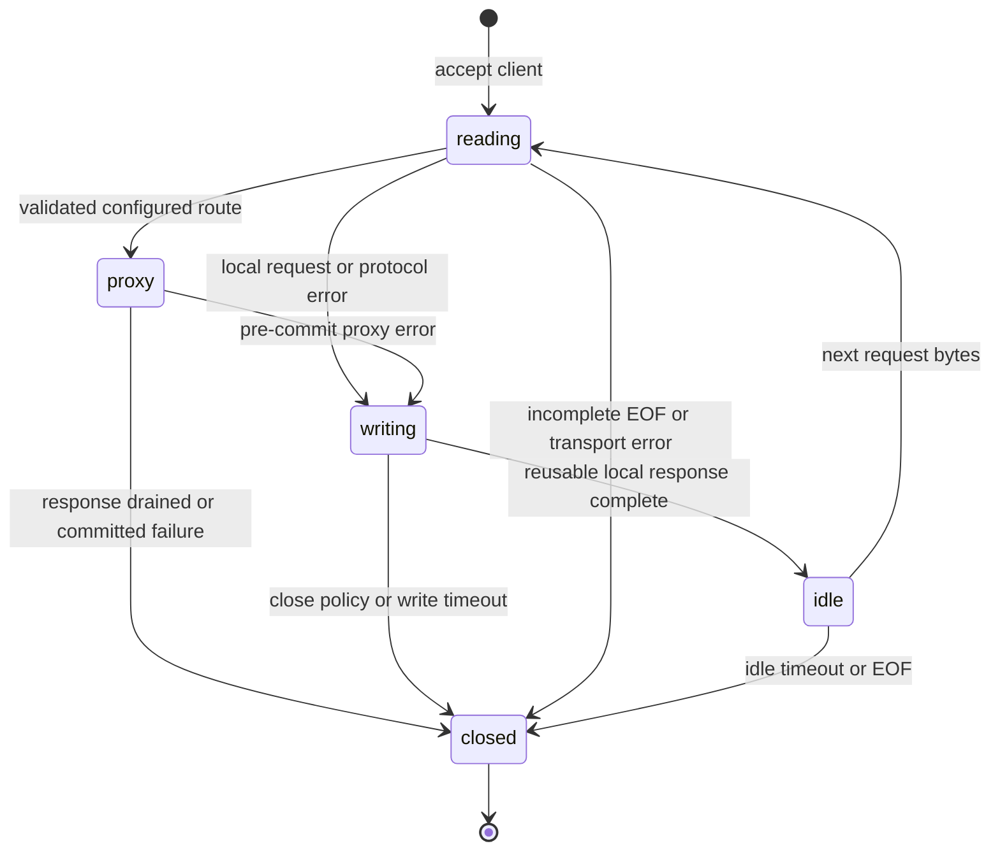
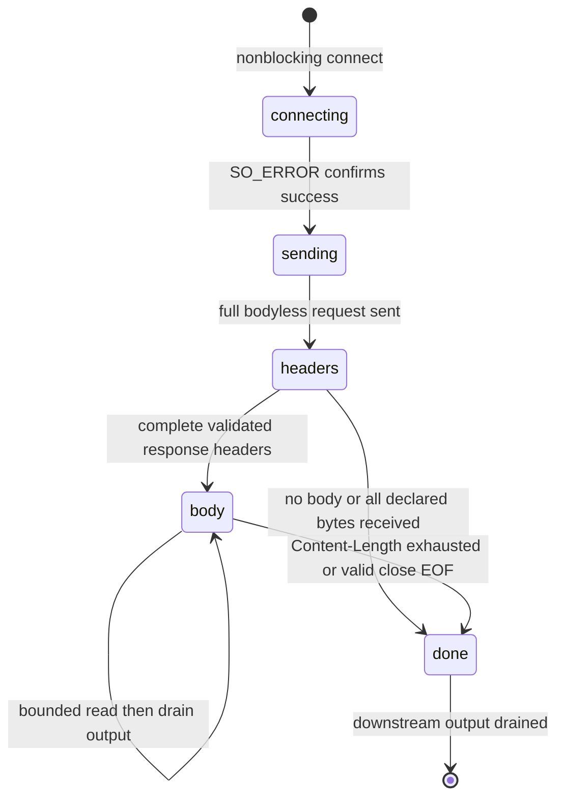

# Architecture through Phase 5B

ZigGate retains its single-threaded, level-triggered Linux epoll engine. `core/server.zig` creates the listener and transfers ownership to the event loop; `core/event_loop.zig` owns client slots, upstream transaction slots, descriptor registration, event dispatch, and deadline scheduling. Listener and accepted sockets are explicitly NONBLOCK/CLOEXEC. `posix.connect` is used only with nonblocking numeric IPv4 upstream sockets. No resolver or blocking network operation runs in the event loop.

## Modules and ownership

- `cli/commands.zig` parses bounded options and repeated proxy routes. `proxy/proxy_config.zig` validates numeric destinations once at startup and selects longest prefixes after reserving exact internal paths. Prefix/authority slices borrow process arguments, whose lifetime encloses the server loop.
- `core/connection.zig` validates client headers with the existing HTTP parser before local routing or entering proxy state. Each client retains its original 8192-byte input and 1024-byte local-response buffers, socket peer IPv4 bytes, request count, and optional upstream-slot index.
- `proxy/headers.zig` validates and iterates fields, handles repeated Connection token lists, filters fixed/nominated hop fields, and appends fields into caller-owned bounded buffers. Connection nominations cannot conceal framing or Host. Forwarding metadata is stripped and reconstructed from the socket peer.
- `proxy/reverse_proxy.zig` serializes bodyless requests with the configured Host and original target. It validates complete upstream status/header blocks and reconstructs response headers without hop-by-hop fields. These functions own no descriptors and allocate no memory.
- `proxy/upstream_connection.zig` owns one transaction's socket, connect/request-send/header/body/done state, framing counters, deadlines, commitment flag, and fixed buffers. Completed proxy transactions close the client, so there is no upstream pooling, retry, or response queue.

The client pool is bounded by `--max-connections`. The upstream pool is allocated only when routes exist and bounded by `--max-upstreams`; each active slot has 16 KiB request, 8 KiB header, and 16 KiB output storage. Active is distinct from an open descriptor: a completed upstream socket may be closed while its last output is still draining. Slot release follows client completion or failure. No request/body data is heap-allocated during a transaction.

## States and epoll interests

The event token contains the client slot index, a 32-bit client generation, and one reserved side bit for upstream events. Stale events cannot target a reused client slot. The upstream slot is resolved through the live client's link; each client can have only one proxy transaction before closing. Supporting future proxied keep-alive/reconnects will require an additional upstream generation policy.

Client reading/idle states subscribe to IN. Local writing subscribes to OUT. During proxying, the client subscribes to OUT only while a bounded output block is pending, plus RDHUP until peer half-close is known. Upstream connecting/sending subscribes to OUT; writable connect completion is always checked with SO_ERROR. Header/body reads subscribe to IN. While output is pending, the upstream is explicitly removed from epoll, preventing reads and repeated HUP readiness. Draining output re-adds read interest. A done upstream socket is deregistered/closed even while its final output remains buffered. Transport errors affect the relevant connection rather than terminating the event loop.

The production transport uses nonblocking recv/send and MSG_NOSIGNAL. Driver methods accept a transport parameter internally so deterministic tests exercise real state transitions and offsets with scripted EAGAIN, failed connects, short sends, and fragmented reads. POSIX wrappers retry EINTR; raw epoll_wait returns to the scheduler after EINTR so deadlines are recalculated. Accept is limited to 64 calls per listener event. Listener quota failures disable its readiness briefly rather than spinning.

## Framing, streaming, and commitment

Client header size is inclusive: request line, all field bytes, and CRLFCRLF total at most 8192. The parser runs before proxy selection. Request bodies, transfer encodings, and Expect retain their strict rejection behavior; they are not silently consumed or forwarded. Exact internal paths beat configured routes; prefix comparison uses the raw path, while forwarding retains the entire original target.

An upstream request is fully reconstructed into fixed storage before connecting, with a validated configured authority, sanitized forwarding metadata, Content-Length: 0, and Connection: close. Header-token filtering scans the entire header block so nominations apply regardless of field ordering. Unsupported upgrade/tunnel requests are rejected before connecting.

Response headers are accumulated only up to the configurable inclusive cap (maximum 8192 status-line/field/terminator bytes). No response byte is sent until status, field syntax, Connection tokens, and framing are validated. Informational responses, all transfer encodings, duplicate/invalid lengths, and invalid no-body framing are rejected. Content-Length is tracked with an unsigned 64-bit remaining count. HEAD/204/205/304 framing forwards no body; valid HEAD/304 representation length metadata is preserved. Ordinary responses without a length are close-delimited and force downstream closure.

The header receive buffer may include initial body bytes. After validation, those bytes join the reconstructed header in the bounded output block; extra bytes beyond a known length are rejected before forwarding. Further reads are at most 8192 bytes and never exceed a known remaining length. Each block must drain before another read. No trailing bytes are interpreted as another response, and completed upstream connections are never reused. EOF before a known length completes is truncation; EOF in close-delimited mode is success.

The commitment flag is set on the first positive client send. Errors before commitment can replace buffered output with one local 502/503/504 response. Errors after commitment only close the client and upstream; a second HTTP status is never serialized. Once a response has started, malformed/truncated body delivery cannot be replaced with an error page.

## Deadlines and cleanup

One monotonic timer drives the scheduler, which scans bounded slots and waits at most 50 ms or until the nearest deadline. Existing client header/idle/write deadlines are preserved. A proxy transaction separately tracks absolute connect, full request-send, and full header-read deadlines; body read waiting starts when client output drains. Each queued output block has an absolute client write deadline that short sends do not extend. A separate absolute total lifetime includes all stages, slow-reader backpressure, and trickling bodies. Thus neither end can retain a transaction indefinitely by making tiny progress.

502 represents refusal, invalid upstream headers/framing, and other pre-commit transport failures; timeout failures use 504. Capacity exhaustion uses 503. Post-commit failure closes both sides. Client release deinitializes its linked upstream before closing the client. Registration/start failures close partially acquired resources. Deferred cleanup handles remaining clients, pool storage, epoll, and listener on error unwinding. Signal termination uses signalfd and explicit draining/forced states; the loop closes the listener immediately and releases all owned resources on completion. See [operational notes](production-hardening.md).

Tests preserve the Phase 1/2 suites and add protocol/configuration/streaming unit coverage and a dedicated raw mock-backend integration suite. Deterministic tests cover short IO/backpressure and a body much larger than buffers without sockets. All live integration suites ran with explicit loopback permissions in the Phase 4A validation. No production performance or security certification is implied.

## Concurrency regression fixtures

The proxy mock backend remains a ThreadingTCPServer, but explicitly configures a 256-connection listen backlog. Python 3.14's inherited backlog of 5 was a fixture capacity defect: concurrency in handlers begins after accept and cannot prevent the pending-connection queue from overflowing during an upstream burst. Ordinary proxy integration timeouts stay at 500 ms. Synchronized 64- and 100-worker waves and a direct 100-client backend preflight distinguish backend overload from proxy failures. Socket-free tests exercise TCPServer's actual bind/activate path using a mocked socket and verify the backlog passed to listen, as well as the inherited threaded dispatcher.

Slow-response/fairness tests gate a handler after it has received the full request; this separates read timeout from connect timeout. A Linux saturated accept queue, checked with a nonblocking pending-connect probe, separately exercises a 100 ms connect deadline while a 3-second read deadline rules out a mistaken read-timeout success. Repeated successful/refused/malformed requests and connect timeouts check descriptor recovery. A deterministic Zig transport test also confirms that repeated pending-connect readiness, EAGAIN, and partial header reads never extend their stage deadlines. No production epoll, framing, capacity, or timeout policy changed for this regression fix. The fixture checks and live proxy suite pass in the Phase 4A validation.

## Phase 4A observability and shutdown modules

`core/shutdown.zig` owns the blocked signal mask, signalfd, explicit shutdown state and grace deadline. The event loop registers its reserved token and processes signals before accepts. Idle clients close during draining; active operations retain normal deadlines and close after completion. A second delivered signal or grace expiry forces cleanup.

`observability/logger.zig` serializes fixed-size JSONL records to a separately opened nonblocking stderr pipe; unsupported sinks and full pipes drop records with no queue. `observability/metrics.zig` holds saturating numeric counters without locks or allocation. The loop records request observations before freeing their resources and emits periodic/final snapshots. The CLI validates new bounds and offers a validation-only mode. No HTTP metrics endpoint or new configuration format is introduced.

## Phase 4B TLS transport

`tls/config.zig` validates an explicit IPv4 HTTPS listener, a required default certificate/key pair, an absolute handshake budget and at most eight exact SNI names. `tls/context.zig` owns stable-address callback state and all OpenSSL contexts, loaded before listeners open. `tls/openssl_shim.c` centralizes OpenSSL macro policy behind Zig C interoperability. `tls/session.zig` owns each client's SSL object, nonblocking handshake/read/write/shutdown operations and readiness direction. HTTP parsing and response serialization remain independent of TLS.

The event loop owns both listeners and shares client/upstream pools between them. HTTPS accepts enter `tls_handshake`, reach HTTP states only on handshake success, and may enter bounded `tls_shutdown` before resource release. WANT_READ/WANT_WRITE overrides HTTP epoll interests; pending decrypted bytes receive bounded synthetic events while polling the rest of epoll. Existing upstream output buffers are passed through the same client transport and never modified across an OpenSSL write retry. Transport-derived forwarding metadata describes the inbound HTTPS scheme while upstream sockets remain plaintext. Forced cleanup bypasses queued close states and frees every SSL before its fd, then contexts after the loop. Phase 5A adds two fixed certificate generations with Session-held registry references; reload never mutates an SSL_CTX used by an active SSL object. See [TLS lifecycle and security boundaries](tls.md).

## Phase 5A admission and reload ownership

`tls/admission.zig` owns a bounded permit counter. A Session acquires before SSL allocation and releases exactly once on successful handshake or deinit; failed construction uses errdefer. The generation registry reference is independent and lasts until SSL_free. This protects old SNI callbacks even when an accepted handshake starts after a reload has activated.

`tls/context.zig` holds two stable Generation slots. The inactive slot must have zero references before preparation; errors free partial contexts and leave the active index unchanged. Commit flips one index, retires the previous slot, and frees retired contexts when its final Session releases. The C shim parses bounded in-memory PEM data with OpenSSL and validates adjacent issuer/signatures. Regular files are opened and checked once before bounded reads, preventing pipe/device loads and pathname reopening races.

The signalfd mask now includes SIGHUP. Signal work per batch and reload attempts per second are bounded, with termination taking priority over reload. Preparation is synchronous regular-file/crypto work, explicitly outside network-nonblocking guarantees. Deadline checks refresh monotonic time after preparation and before each dispatch. No worker thread, cross-thread context transfer or unbounded generation queue is added.

## Phase 5B ACME worker boundary

The optional ACME Manager is initialized at a stable main-thread address before listener creation. It opens private fd-relative storage and validates existing state without network IO. The event loop starts one worker after signalfd signals are blocked, so worker/resolver threads inherit the correct mask. HTTP dispatch copies published challenge bodies under a short mutex before proxy matching. Network calls, JWS/CSR generation, strict issuance validation and durable storage writes stay in the worker.

A bounded publication slot transfers only a bundle index/expiration and counters to the loop. Activation calls `Contexts.reloadWith` with stable `/proc/self/fd/...` paths anchored to the retained storage fd. No OpenSSL SSL_CTX/SSL object is shared between worker crypto and event-loop transport. Three disk bundle slots preserve selected/currently served material; the two in-memory TLS generations remain unchanged. Rate limits, polling/call caps and persisted backoff prevent overlapping renewal loops. Shutdown cancels and joins the worker before its storage/shared memory is destroyed. See [ACME architecture and limits](acme.md).
